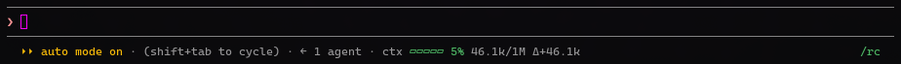
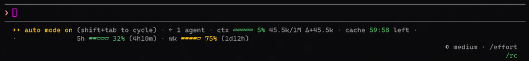

# context-meter

Shows how full the context window is, and how much the last turn added, on the line under the prompt:



- The gauge is green below 50%, yellow from 50% and red from 80%.
- `Δ` is what the last main-conversation turn added. After a compaction it reads as a negative number followed by `compacted`.
- Before the first reply it shows only the window size: `ctx ▱▱▱▱▱ —/200k`.
- At 80% a toast suggests `/compact`. It shows once, then again only after the fill has dropped below 75%.
- `/clear` resets the meter.

It shares the row with [cache-timer](../cache-timer/) and [usage-limits](../usage-limits/) when they're installed, and always comes first.



## Install

```bash
claude plugin marketplace add cloudaura-io/cloudaura-marketplace
claude plugin install context-meter@cloudaura-marketplace
```

## Tests

```bash
claude plugin test plugins/context-meter
```
