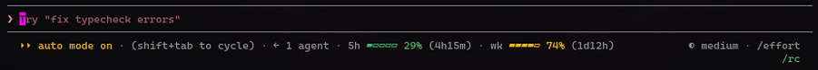

# usage-limits

Shows your rate-limit windows and when each one resets, on the line under the prompt:



- Each gauge is green below 70%, yellow from 70% and red from 90%.
- At 90% a window gets one toast with its reset countdown, once per window period.
- The countdowns update every minute. A window whose reset time has passed reads `0% (reset)` until the next reading.
- A leading `~` means the figures are from your last session, shown until this session's first reply. `limits: waiting` means there are no figures yet.
- Windows are listed as `5h`, `wk`, `wk opus`, `wk sonnet`, then `spend`, whichever your account has.
- Accounts without rate-limit windows (API key, Bedrock, Vertex) show nothing after the first reply.

It shares the row with [context-meter](../context-meter/) and [cache-timer](../cache-timer/) when they're installed, and always comes last.


## Install

```bash
claude plugin marketplace add cloudaura-io/cloudaura-marketplace
claude plugin install usage-limits@cloudaura-marketplace
```

## Tests

```bash
claude plugin test plugins/usage-limits
```
